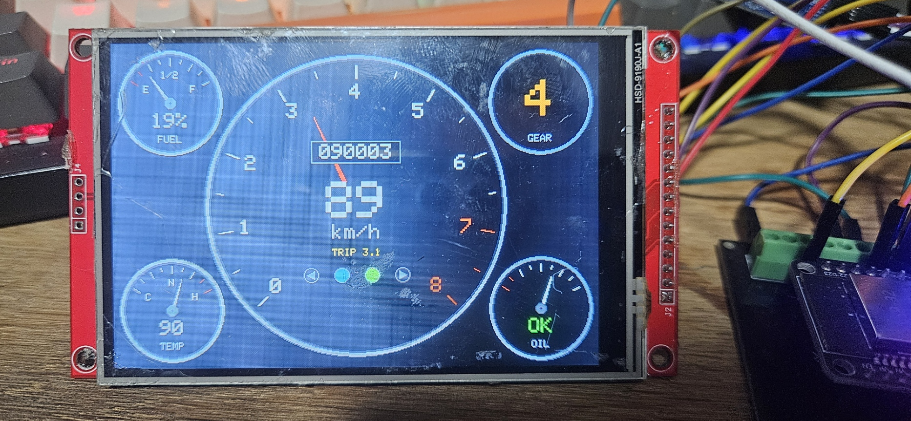
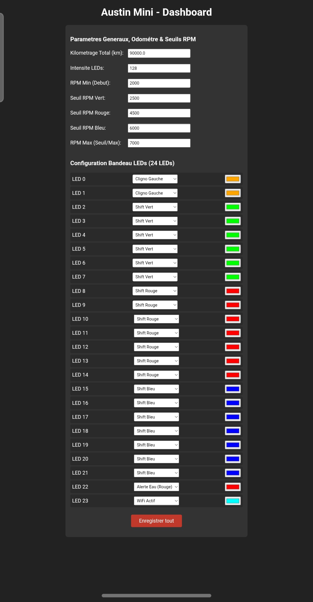
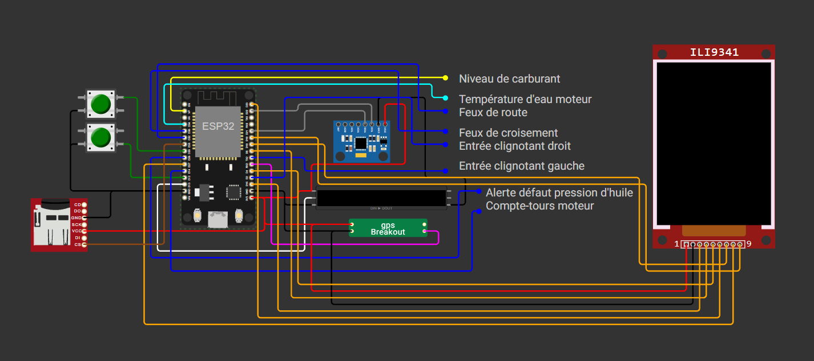

# 🏎️ Restomod Digital Dashboard - Austin Mini (ESP32)

Tableau de bord numérique moderne de type "Fast Road / GT" développé pour une Austin Mini Cosmopolitan de 1993. Le système repose sur un microcontrôleur **ESP32 (30 broches)** et combine un affichage graphique SPI, un bandeau de LEDs adressables WS2812B pour le shift-light et les voyants, une centrale inertielle MPU-6050, un module GPS, ainsi qu'un serveur Web embarqué via Wi-Fi pour la configuration dynamique et la consultation du journal de trajets.

---

## 📸 Aperçu du Projet

| Vue d'ensemble du Dashboard | Interface Web & Paramétrage |
| :---: | :---: |
|  |  |
| *Affichage TFT vintage / course* | *Configuration web (Seuils RPM & Rôles LEDs)* |

---

## ✨ Fonctionnalités Principales

### Affichage TFT (3 pages, bouton Page)
1. **Page 1 – Cadrans Smiths vintage (fond crème) :** grand compte-tours central (0–8000 tr/min, zone rouge dès 7000) intégrant la **vitesse GPS numérique**, le **kilométrage total**, le **trip partiel**, la **tension de batterie** et les voyants (clignotants, feux de croisement, pleins phares). Quatre cadrans auxiliaires : jauge d'essence, rapport engagé, température d'eau et **horloge numérique** (heure GPS, passage automatique heure d'été / hiver).
2. **Page 2 – Tableau de bord course :** barre de régime symétrique en dégradé avec valeur centrale, **rapport engagé géant** qui clignote en rouge quand il faut changer de vitesse, vitesse GPS, radar **G-Force** (latéral / accélération), distance (trip et total) et panneau moteur (eau, huile, essence, tension de batterie).
3. **Page 3 – Réglages & système :** statut du point d'accès Wi-Fi (et adresse IP), kilométrage total, trip partiel, état du **MPU6050**, du **GPS** et du **mode démo**.

### Animation de démarrage
Silhouette de la Mini en blanc sur fond noir qui arrive à l'écran, route qui défile, phare qui s'allume, titre « AUSTIN MINI » lettre par lettre, accompagnée d'une comète puis d'un remplissage sur le bandeau de LEDs. Un appui sur le bouton Page la passe.

### Rapport engagé calculé
Le rapport est déduit du régime et de la vitesse GPS à partir des rapports de boîte (1ère à 4ème), du rapport de pont et de la circonférence de roue, tous réglables sur l'interface Web. Un ratio mesuré en direct aide au réglage. Sous 3 km/h, le point mort (N) est affiché.

### Alerte surchauffe moteur
Au-dessus du seuil réglable (100 °C par défaut), l'écran passe en rouge clignotant plein écran avec la température. Un appui sur le bouton Page l'acquitte ; elle se réarme 3 °C plus bas.

### Luminosité automatique
Quand les feux (croisement ou route) sont allumés, le rétroéclairage et les LEDs baissent progressivement. Valeurs jour / nuit réglables, fonction désactivable.

### Journal de trajets (mémoire interne)
Un trajet démarre au-dessus de 5 km/h et se termine après 5 minutes d'arrêt. Chaque trajet enregistre date, heure, durée, distance, vitesse max et moyenne, température d'eau max, essence au début et à la fin. Le trajet en cours est sauvegardé toutes les 30 secondes (la coupure du contact éteint l'ESP32) et ajouté au journal au démarrage suivant. Les 60 derniers trajets sont conservés dans la mémoire interne (LittleFS) ; consultation, téléchargement CSV et effacement depuis l'interface Web.

### Mode démonstration
Simulation autonome d'un cycle de conduite de 36 secondes en boucle (accélération 0–120 km/h, rapports, régime, température d'eau avec alerte, tension de batterie, clignotants, feux, forces G, horloge) sans aucun capteur branché. L'odomètre enregistré n'est pas modifié. Activable / désactivable depuis l'interface Web (choix mémorisé).

### Bandeau LED WS2812B (24 LEDs configurables)
Disposition par défaut : **4 LEDs de voyants à gauche (LED 0-3), 16 LEDs de shift-light au centre (LED 4-19), 4 LEDs de voyants à droite (LED 20-23)**.
- **Shift-light :** seuils personnalisables Vert / Rouge / Bleu ; au RPM max, toutes les LEDs du shift-light clignotent.
- **Rôles affectables LED par LED :** Shift Vert / Rouge / Bleu, clignotant gauche, clignotant droit, voyant température d'eau, voyant huile, voyant Wi-Fi, feux de croisement, feux de route, voyant essence (< 15 %), voyant alternateur.
- **Couleur RGB** et option **« Clignote »** pour chaque LED, avec **repérage** : la LED choisie clignote seule pendant 6 secondes quand on la sélectionne.

### Serveur Web embarqué (mode AP)
Réglage du kilométrage, de l'intensité des LEDs, du mode démo, des seuils RPM, de la boîte de vitesses, de la luminosité auto, de l'alerte surchauffe et du facteur de la tension de batterie ; configuration des 24 LEDs ; **calibration du gyroscope** (bouton) ; journal de trajets (tableau des 8 derniers, téléchargement CSV, effacement).

### Persistance en mémoire Flash
Kilométrage total, trip partiel (remise à zéro par appui long de 2 secondes sur le bouton Page), offsets du gyroscope et configuration complète via la bibliothèque `Preferences`.

---

## 📌 Schéma de Câblage Global



---

## 🔌 Tableaux des Assignations de Broches (Pinout)

> ⚠️ **Notes importantes sur le câblage :**
> - Le **voyant alternateur** est sur le **GPIO 19**, qui est aussi la broche MISO du bus SPI. Dans `User_Setup.h`, il faut mettre `#define TFT_MISO -1` (l'écran n'est jamais lu).
> - La **carte SD a été retirée** : le GPIO 2 est libre.
> - La **tension de batterie** utilise le GPIO 39 (entrée analogique seule) avec un pont diviseur.

### 🔌 Connecteur GX16 (10 broches - Écran & LEDs)
| Broche GX16 (10 pins) | Destination / Rôle | Broche ESP32 / Bus |
| :---: | :--- | :--- |
| **Pin 1** | VCC / Alimentation Écran | **5V** ou **3.3V** |
| **Pin 2** | GND Masse Écran & LEDs | **GND** |
| **Pin 3** | SPI MOSI (`TFT_MOSI`) | **GPIO 23** |
| **Pin 4** | SPI SCK (`TFT_SCLK`) | **GPIO 18** |
| **Pin 5** | TFT Chip Select (`TFT_CS`) | **GPIO 15** |
| **Pin 6** | TFT Data/Command (`TFT_DC`) | **GPIO 4** |
| **Pin 7** | TFT Reset (`TFT_RST`) | **GPIO 5** |
| **Pin 8** | Rétroéclairage (`TFT_BL` / `PIN_BACKLIGHT`) | **GPIO 27** |
| **Pin 9** | Données Bandeau LEDs (`PIN_LED_DATA`) | **GPIO 13** |
| **Pin 10** | Libre (ancien SD Chip Select) | – |

### 🖥️ Affichage TFT (Bus SPI matériel)
| Broche Périphérique | Rôle / Description | Broche ESP32 |
| :--- | :--- | :--- |
| **MOSI (SDA)** | Données SPI | **GPIO 23** |
| **SCK (SCL)** | Horloge SPI | **GPIO 18** |
| **CS** | Chip Select de l'écran | **GPIO 15** |
| **DC** | Data / Command | **GPIO 4** |
| **RST** | Reset | **GPIO 5** |
| **BL (Backlight)** | Rétroéclairage, PWM pour la luminosité auto (`PIN_BACKLIGHT`) | **GPIO 27** |

### ⚙️ Entrées Numériques, Commandes & Voyants (TOR)
| Composant / Signal | Rôle / Description | Broche ESP32 |
| :--- | :--- | :--- |
| **Bouton Page** | Changement de page (appui court) / acquittement de l'alerte surchauffe / Reset Trip (appui long ≥ 2 s) (`PIN_PAGE_BTN`) | **GPIO 12** |
| **Bouton Wi-Fi** | Bascule du point d'accès AP (`PIN_WIFI_BTN`) | **GPIO 25** |
| **Signal RPM** | Compte-tours moteur (`PIN_RPM`, interruption) | **GPIO 14** |
| **Pression d'huile** | Alerte défaut pression d'huile (`PIN_OIL`) | **GPIO 26** |
| **Clignotant gauche** | Entrée clignotant gauche (`PIN_IND_L`) | **GPIO 17** |
| **Clignotant droit** | Entrée clignotant droit (`PIN_IND_R`) | **GPIO 33** |
| **Feux de croisement** | Entrée phares (`PIN_LIGHTS`) – résistance 10 kΩ vers 3,3 V (entrée seule) | **GPIO 35** |
| **Pleins phares** | Feux de route (`PIN_HIGH_BEAM`) | **GPIO 32** |
| **Voyant alternateur** | Défaut de charge (`PIN_ALT`), optocoupleur vers GND, pull-up interne | **GPIO 19** |

### 📊 Entrées Analogiques (ADC)
| Capteur | Rôle / Description | Broche ESP32 |
| :--- | :--- | :--- |
| **Sonde Température** | Température d'eau moteur (`PIN_TEMP`) | **GPIO 34** |
| **Jauge Essence** | Niveau de carburant (`PIN_FUEL`) | **GPIO 36** (VP) |
| **Tension batterie** | Pont diviseur 100 kΩ (vers +12 V) / 22 kΩ (vers GND) + 100 nF vers GND (`PIN_VBAT`) | **GPIO 39** (VN) |

### 🛠️ Périphériques & Bus de Communication
| Périphérique | Rôle / Description | Broches ESP32 |
| :--- | :--- | :--- |
| **Bus I2C** | Centrale inertielle MPU-6050 (`PIN_SDA` / `PIN_SCL`) | **GPIO 21** (SDA) / **GPIO 22** (SCL) |
| **Bus UART2** | Module GPS (`PIN_GPS_RX` / `PIN_GPS_TX`) | **GPIO 16** (RX) / TX non connecté (`-1`) |
| **Bandeau LED** | Données du bandeau WS2812B (`PIN_LED_DATA`) | **GPIO 13** |

---

## ⚙️ Configuration de TFT_eSPI (`User_Setup.h`)

```cpp
#define ST7796_DRIVER
#define TFT_MOSI 23
#define TFT_MISO -1      // GPIO 19 réservé au voyant alternateur
#define TFT_SCLK 18
#define TFT_CS   15
#define TFT_DC   4
#define TFT_RST  5
#define TFT_BL   27
#define SPI_FREQUENCY 27000000
#define TFT_RGB_ORDER TFT_BGR
#define LOAD_GLCD
```

Le code utilise la bibliothèque `LittleFS` pour le journal de trajets.

---

## 🌐 Connexion Wi-Fi & Configuration

1. Appuyer sur le bouton Wi-Fi (`GPIO 25`) pour démarrer le point d'accès.
2. Se connecter au réseau Wi-Fi : `Mini-Dashboard-AP` (mot de passe : `minicooper`).
3. Ouvrir un navigateur web à l'adresse : `http://192.168.4.1`.
4. Depuis la page web : calibrer le gyroscope, consulter ou télécharger le journal de trajets (`.csv`), régler les paramètres généraux, la boîte de vitesses, la luminosité, les alertes, et configurer les 24 LEDs (rôle, couleur, clignotement). Penser à cliquer sur **Enregistrer tout**.

---

## 🛠️ Matériel Utilisé
- Microcontrôleur ESP32 (30 broches)
- Écran TFT SPI 480x320 (contrôleur ST7796S)
- Centrale inertielle MPU-6050
- Module GPS UART
- Bandeau LED WS2812B (24 LEDs)
- Optocoupleurs pour les signaux de la voiture (RPM, feux, clignotants, huile, alternateur)
- Ponts diviseurs pour la jauge d'essence, la sonde de température d'eau et la tension de batterie
