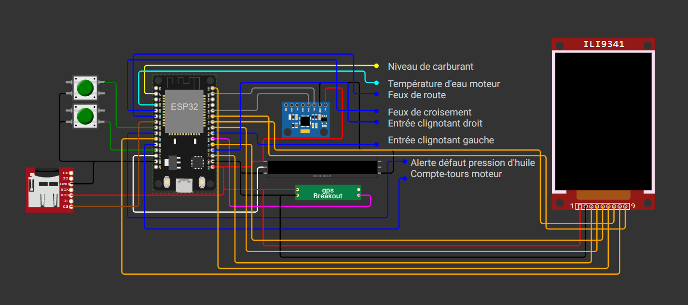

# 🏎️ Restomod Digital Dashboard - Austin Mini (ESP32)

Tableau de bord numérique moderne de type "Fast Road / GT" développé pour une Austin Mini classique. Le système repose sur un microcontrôleur **ESP32 (30 broches)** et combine un affichage graphique SPI, un bandeau de LEDs adressables WS2812B pour le shift-light et les alertes, un lecteur de carte SD, une centrale inertielle MPU-6050, un module GPS, ainsi qu'un serveur Web embarqué via Wi-Fi pour la configuration dynamique et l'export des données de vol/trajet.

---

## 📸 Aperçu du Projet

| Vue d'ensemble du Dashboard | Interface Web & Paramétrage |
| :---: | :---: |
|  |  |
| *Affichage TFT vintage / course* | *Configuration web (Seuils RPM & Rôles LEDs)* |

---

## ✨ Fonctionnalités Principales

- **Affichage TFT (3 Pages de Navigation) :**
  1. *Page 1 (Magnolia Vintage & Compte-tours) :* Vitesse GPS, Compte-tours analogique/numérique, rapport engagé (calculé), jauge d'eau, pression d'huile, jauge d'essence, et odomètre total.
  2. *Page 2 (Race Digital & G-Force) :* Barre de régime progressive en dégradé, régime numérique, rapport engagé géant, vitesse GPS et radar G-Force dynamique.
  3. *Page 3 (Réglages & Système) :* Statut du point d'accès Wi-Fi, kilométrage total, trip partiel, et contrôle en temps réel de l'état opérationnel des périphériques (**Carte SD**, **MPU6050** et **GPS**).
- **Gestion Carte SD & Datalogging :**
  * Affichage d'une image de démarrage personnalisée (`/logo.bmp`) au boot.
  * Enregistrement automatique et périodique des données de trajet (temps, vitesse, régime moteur, températures, alertes et odométrie) dans un fichier de logs horodaté (`/trip_log.csv`).
- **Bandeau LED WS2812B (24 LEDs configurables) :**
  * *Shift-Light progressif :* Seuils personnalisables pour le **Vert**, le **Rouge** et le **Bleu**, avec clignotement global en cas de dépassement du RPM Max.
  * *Rôles multiples affectables LED par LED :* Clignotants (gauche/droit), alertes eau/huile, statut Wi-Fi, ou éclairage fixe/feux.
- **Serveur Web Embarqué (Mode AP) :**
  * Connexion directe en Wi-Fi pour administrer le système, régler la luminosité, les seuils RPM, l'assignation des LEDs, et **télécharger directement le fichier de logs CSV (`/trip_log.csv`)** de la carte SD.
- **Persistance en Mémoire Flash :**
  * Sauvegarde automatique du kilométrage total et du trip partiel via la bibliothèque `Preferences`.

---

## 📌 Schéma de Câblage Global

---
## 🔌 Tableaux des Assignations de Broches (Pinout)

### 🔌 Connecteur GX16 (10 Broches - Écran, LEDs & SD)
| Broche GX16 (10 pins) | Destination / Rôle | Broche ESP32 / Bus |
| :---: | :--- | :--- |
| **Pin 1** | VCC / Alimentation Écran | **5V** ou **3.3V** |
| **Pin 2** | GND Masse Écran & LEDs | **GND** |
| **Pin 3** | SPI MOSI (`TFT_MOSI`) | **GPIO 23** (`23`) |
| **Pin 4** | SPI SCK (`TFT_SCLK`) | **GPIO 18** (`18`) |
| **Pin 5** | TFT Chip Select (`TFT_CS`) | **GPIO 15** (`15`) |
| **Pin 6** | TFT Data/Command (`TFT_DC`) | **GPIO 4** (`4`) |
| **Pin 7** | TFT Reset (`TFT_RST`) | **GPIO 5** (`5`) |
| **Pin 8** | Rétroéclairage (`TFT_BL` / `PIN_BACKLIGHT`) | **GPIO 27** (`27`) |
| **Pin 9** | Données Bandeau LEDs (`PIN_LED_DATA`) | **GPIO 13** (`13`) |
| **Pin 10** | SD Chip Select (`SD_CS`) | **GPIO 33** (`33`) |
### 🖥️ Affichage TFT & Carte SD (Bus SPI Partagé)
| Broche Périphérique | Rôle / Description | Broche ESP32 |
| :--- | :--- | :--- |
| **MOSI (SDA)** | Données SPI (Master Out - Partagé) | **GPIO 23** |
| **MISO** | Données SPI (Master In - Partagé) | **GPIO 19** |
| **SCK (SCL)** | Horloge SPI (Clock - Partagé) | **GPIO 18** |
| **SD_CS** | Chip Select de la Carte SD | **GPIO 33** |
| **BL (Backlight)** | Rétroéclairage écran (`PIN_BACKLIGHT`) | **GPIO 27** |

### ⚙️ Entrées Numériques, Commandes & Sécurité (TOR)
| Composant / Signal | Rôle / Description | Broche ESP32 |
| :--- | :--- | :--- |
| **Bouton Page** | Changement de page écran (`PIN_PAGE_BTN`) | **GPIO 12** |
| **Bouton Wi-Fi** | Bascule du point d'accès AP (`PIN_WIFI_BTN`) | **GPIO 25** |
| **Signal RPM** | Compte-tours moteur (`PIN_RPM` - Interruption) | **GPIO 14** |
| **Pression d'huile** | Alerte défaut pression d'huile (`PIN_OIL`) | **GPIO 26** |
| **Clignotant gauche** | Entrée clignotant gauche (`PIN_IND_L`) | **GPIO 17** |
| **Clignotant droit** | Entrée clignotant droit (`PIN_IND_R`) | **GPIO 2** |
| **Phares / Feux** | Feux de croisement (`PIN_LIGHTS`) | **GPIO 35** |
| **Pleins Phares** | Feux de route (`PIN_HIGH_BEAM`) | **GPIO 32** |

### 📊 Entrées Analogiques (ADC)
| Capteur | Rôle / Description | Broche ESP32 |
| :--- | :--- | :--- |
| **Sonde Température** | Température d'eau moteur (`PIN_TEMP`) | **GPIO 34** |
| **Jauge Essence** | Niveau de carburant (`PIN_FUEL`) | **GPIO 36** (VP) |

### 🛠️ Périphériques & Bus de Communication
| Périphérique | Rôle / Description | Broches ESP32 |
| :--- | :--- | :--- |
| **Bus I2C** | Centrale inertielle MPU-6050 (`PIN_SDA` / `PIN_SCL`) | **GPIO 21** (SDA) / **GPIO 22** (SCL) |
| **Bus UART2** | Module GPS (`PIN_GPS_RX` / `PIN_GPS_TX`) | **GPIO 16** (RX) / TX non connecté (`-1`) |
| **Bandeau LED** | Données du bandeau WS2812B (`PIN_LED_DATA`) | **GPIO 13** |
## 🌐 Connexion Wi-Fi, Configuration & Récupération des Logs

Pour interagir avec le tableau de bord :
1. Appuyer sur le bouton Wi-Fi (`GPIO 25`) pour démarrer le point d'accès.
2. Se connecter au réseau Wi-Fi : `Mini-Dashboard-AP` (Mot de passe : `minicooper`).
3. Ouvrir un navigateur web à l'adresse : `http://192.168.4.1`
4. Depuis la page web, vous pouvez configurer les paramètres généraux, le comportement des LEDs, ou cliquer sur le lien pour **télécharger vos logs de trajet au format `.csv`**.

---

## 🛠️ Matériel Utilisé
- Microcontrôleur ESP32 (30 broches)
- Écran TFT SPI (contrôleur type ST7796S)
- Centrale inertielle MPU-6050
- lecteur de carte SD 
- Module GPS UART
- Bandeau LED WS2812B (24 LEDs)
